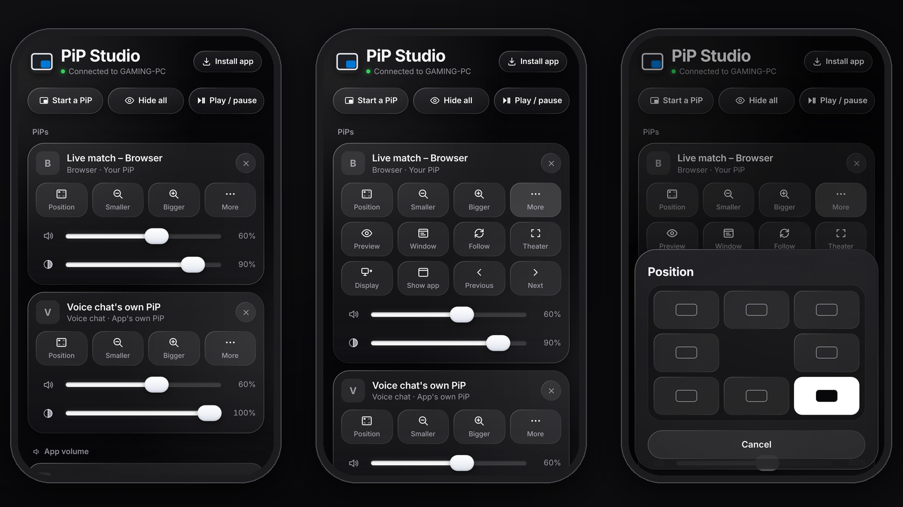
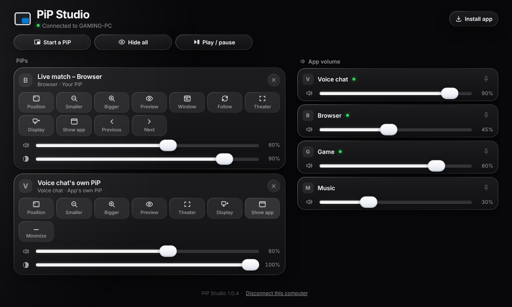

# PiP Studio changelog

## 1.0.4

- **PiPs bump each other**: drop or resize a PiP onto another and the other one is pushed out of the way, so they stack instead of overlapping. Drop one just above (or below) a PiP sitting in a corner and it stacks there; when there's no room to push, the one you moved stacks next to it instead. Locked PiPs stay put. While you drag or resize, faint outlines show where it and the PiPs it pushes will land
- Moving PiPs with a controller or shortcuts works with other PiPs around: a taken spot means stacking next to the PiP there (or pushing it aside), a spot where it wouldn't really move is skipped (or the PiPs swap places, like a tall PiP moving up past a small one), PiPs never end up off-screen, and making one bigger pushes its neighbours aside instead of covering them
- Controller: **left stick left/right switches which PiP you're controlling** (in reading order, its name shows on it), and only that PiP wears the controller outline, so you can tell which one the buttons steer. Also available as keyboard shortcuts (Control the next / previous PiP, unset by default)
- **Side by side** (experimental, Behavior > Experimental, the tray menu, or a shortcut or controller button you set): a strip of the display (the right third by default; left or bottom, 25–50%) is kept for your PiPs, stacked in it. Apps fit beside it, and borderless full-screen games are shrunk to the rest of the display, so nothing covers them. Turning it off puts everything back. Games in exclusive full screen can't be shrunk: PiP Studio says so. In the strip, drag a PiP to change its place in the stack, resize it to give it its own size (the others make room), and move it up or down the stack with the controller or arrow shortcuts
- Restart as administrator no longer makes PiP Studio seem to vanish: its window opens again after the restart (it used to stay in the tray when PiPs came back), and starting PiP Studio again while it runs as administrator brings its window up (it did nothing before). Starting it yourself always opens the window; only starting with Windows stays in the tray
- Game streaming (Moonlight, Steam Link): the outline, title bar and volume pop-up PiP Studio adds to other apps' PiPs now show up in the stream. Like PiP Studio's own PiPs, they're only hidden from capture when "Hide PiPs from screenshots, recordings and screen sharing" is on
- Other apps' menus are no longer mistaken for PiPs: Discord's tray menu (right-clicking Discord in the tray) works again instead of being shrunk by black bar removal and getting a PiP title bar. Only windows you can resize count as another app's PiP, and black bar removal never reshapes a window that can't be resized
- Screen readers: Narrator and other screen readers announce each PiP by name and what it shows
- **Saved layouts**: save the PiPs you have open under a name ("Gaming", "Work") and bring them all back in one go from Running PiPs > Layouts, the tray menu or Behavior > Layouts. A layout can also open by itself when an app starts, and close its PiPs when the app exits
- **Back up settings** (Settings): export your settings, shortcuts and layouts to a file and import them on another PC
- PiP Studio now speaks **Spanish, Portuguese (Brazil), French, German, Russian and Japanese**, next to English, Arabic and Chinese (Settings > General > Language, or it follows Windows)
- Touch screens: drag a finger to scroll the settings, the window lists and drop-down lists
- Long drop-down lists (like Language) scroll with the mouse wheel again, instead of the page behind them
- New **OLED** theme in Settings > Appearance > App theme, next to Light and Dark: true black instead of grey, for PiP Studio's window and menus
- Easier with the keyboard: the arrow keys move between settings, rows and buttons (with a focus ring, like controller mode) instead of just scrolling, and Enter switches, opens or presses the one you're on
- The side menu folds into icons at the same window width on every page, whether explanations are on or not
- A custom accent color now also colors the switches, sliders and main buttons, not only PiP Studio's own highlights
- Phone companion: adding it to your phone's home screen names the shortcut after your PC ("PiP Studio (Your-PC)"), so you can tell PCs apart
- Phone companion on a computer: a wide window shows every PiP button at once (no More) in a denser layout, PiPs and App volume side by side (App volume scrolls on its own), menus open as dialogs in the middle, buttons light up under the mouse, and the page says "this computer" instead of "this phone"
- Phone companion: sliders only move when you drag the knob, so a stray tap on the track no longer jumps the volume; app icons show whole, without a tile behind them
- Phone companion: Show a window lists each window with its app's icon, and a PiP's icon changes when it switches to another app's window
- Phone companion: the page behind a menu (like Show a window) no longer scrolls, and long menus scroll inside themselves
- Phone companion: sliders fill all the way at 100%, and apps running as administrator (like many games) show their icon too
- Setting explanations now play in a small PiP in the lower right corner instead of a panel, so the settings get the whole width. It fades out of the way while the pointer is over it, so the settings under it stay easy to reach. Controller mode keeps the panel. The Phone page has explanations too.

Marking windows as PiPs is clearer and easier to undo:

- "Treat as a PiP" now asks first and explains what it does (the window stays on top, snaps to PiP spots and follows your PiP shortcuts)
- Every window you marked is listed under **Marked as PiPs** on the Running PiPs page, with a Remove button for each (or Remove all)
- Removing a mark makes it a normal window again and takes it off always on top
- Other apps' PiPs stay on the Running PiPs page while they're minimized, with a Restore button to bring them back
- The title bar on other apps' PiPs no longer has a maximize button
- The title bar on other apps' PiPs now sits just above them instead of covering their top (below them when there's no room above)
- Discord's in-game overlay no longer counts as a PiP
- Black bar removal keeps watching: when a Discord stream changes shape while it plays (after loading, or when the streamer switches resolution), the new bars are trimmed off within a few seconds
- Black bar removal works on windows with their own title bar (like a game you marked as a PiP): bars are measured inside the window's picture only, and its shape is kept without the title bar when it's resized
- Full-screen windows can't be treated as PiPs, and a marked window that goes full screen is no longer kept on top, so you can't get stuck under it
- The live preview no longer covers questions PiP Studio asks you

Control PiP Studio from your phone:

  
  

- New **Phone** page in PiP Studio: turn the phone companion on, press **Pair a phone**, scan the QR code, and type the PIN your phone shows (just like pairing Moonlight with Sunshine)
- It opens in your phone's browser (Android or iPhone, nothing to install) and shows every PiP, yours and other apps', with buttons to move, resize, minimize, restore and close them, plus opacity and volume sliders
- Under your PiPs, **App volume** works like Windows' volume mixer: a slider and mute button for every app playing sound, with the apps you actually hear at the top and quiet ones at the bottom: an app that starts playing jumps to the top, the rest re-sorts calmly, and nothing moves while you're using a slider
- Pin the apps you always want at hand to the top of the volume list
- Tap **Install app** to put it on your home screen, where it opens full screen like a real app
- A clean, dark look after Apple's Liquid Glass (glass panels with lit edges, glass capsule sliders that turn clear while you drag): each PiP shows the buttons you use most with its volume and opacity underneath, and the rest under **More** (it goes solid if your phone has Reduce transparency on)
- Every PiP and every app in the volume list shows the app's own icon
- Turn on **Preview** (under More) to see what a PiP is showing, live on your phone
- **Position** puts a PiP on any corner or edge spot with one tap, **Window** switches which window it shows, and **Follow** turns "follow the window I just left" on or off
- It only works on your home network, only for phones you've paired, and everything between your phone and PC is encrypted. You can remove a phone any time

Controller fixes:

- Better in Windows' Xbox mode (the full screen experience on handhelds and gaming PCs): PiP Studio opens straight into its controller layout, Hide PiPs over full-screen apps no longer hides them all the time (every app is full screen there), and its tips say to start PiP Studio again instead of clicking a tray icon that isn't there
- "Release the game's focus" now works reliably when you turn controller controls on with your controller, not only with the keyboard shortcut (Windows used to refuse it unless you hadn't touched the keyboard or mouse for a few minutes)
- If a game runs as administrator, PiP Studio tells you it can't take the game's focus, and offers to restart as administrator, which fixes it
- New **Always start as administrator** in Settings > General: PiP Studio then starts as administrator every time, also at sign-in, without asking (Windows asks once to set it up)

Crash reports:

- If PiP Studio ever crashes, it notices the next time it starts and offers to send a crash report. It opens a bug report on GitHub with the details filled in, so you can see exactly what's sent before you send it
- **Report a problem** in Settings > General > About does the same for anything else that isn't working right

Behind the scenes:

- Settings and your open PiPs are saved more safely, so a crash or power cut can't wipe them

## 1.0.3

Other apps' PiPs get the PiP Studio treatment when you point at them.

- Hover over the PiP window of Chrome, Firefox, Discord or another app and PiP Studio's title bar pops up on top of it
- Drag the bar to move the PiP (it snaps into place when you let go), or scroll on it to change the volume
- It has minimize, maximize and mute buttons, plus the buttons you picked for your own PiPs' title bar: show the app, theater mode, bigger, smaller, next corner, next display and close
- Minimized one that has no taskbar button? Bring it back from PiP Studio's tray menu
- Every title bar now has buttons to make the PiP bigger or smaller (you can turn them off in Settings > Appearance > Title bar buttons)
- Settings > Appearance > Title bar buttons shows a preview of your title bar that updates as you turn buttons on and off or move them
- "Follow the window I just left" is now right in a PiP's menu instead of tucked away under Source
- Don't want it? Turn off "Show controls on other apps' PiPs" in Settings > Behavior

## 1.0.2

PiP Studio can now update itself! No more downloading new versions by hand.

- It checks for a new version once a day and lets you know when one is out
- Click **Update now** in Settings > General > Updates, and it downloads the update and restarts on the new version, with your PiPs right where they were
- Don't want it to check? Turn off "Check for updates automatically" in the same place
- The Microsoft Store version keeps getting its updates from the Store

## 1.0.1

Getting ready for the Microsoft Store. If you use the installer or the portable version, nothing changes for you.

- When it runs as the Store version, "Start when I sign in" uses Windows' startup apps list, and "Settings folder" opens the right place
- The "Restart as administrator" option is hidden in the Store version, since it can't do that

## 1.0.0

First release! 🎉

PiP Studio lets you pop any window out into a small floating picture-in-picture, so you can keep a video, a stream or a guide on screen while you play or work.

- Works with any app, a whole screen, or just part of one
- Also controls the PiPs from your browser, Discord and other apps
- Snaps neatly into corners and stays out of your way
- Can be used entirely with a controller
- Light and dark themes that match Windows

Full disclosure: this app is vibecoded. I built it together with AI (Claude), so expect the odd rough edge, and please report anything weird you run into.

Download **PiPStudio-Setup-1.0.0.exe** below to install it, or grab the portable zip if you don't want to install anything.

If Windows shows a "Windows protected your PC" warning, click **More info** and then **Run anyway**.

Found a bug or have an idea? [Let me know](https://github.com/NauticalNoodles/PiP-Studio/issues/new/choose)!
