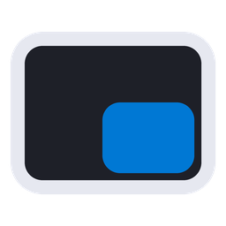
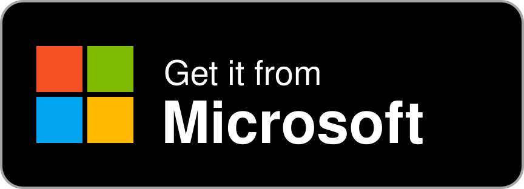
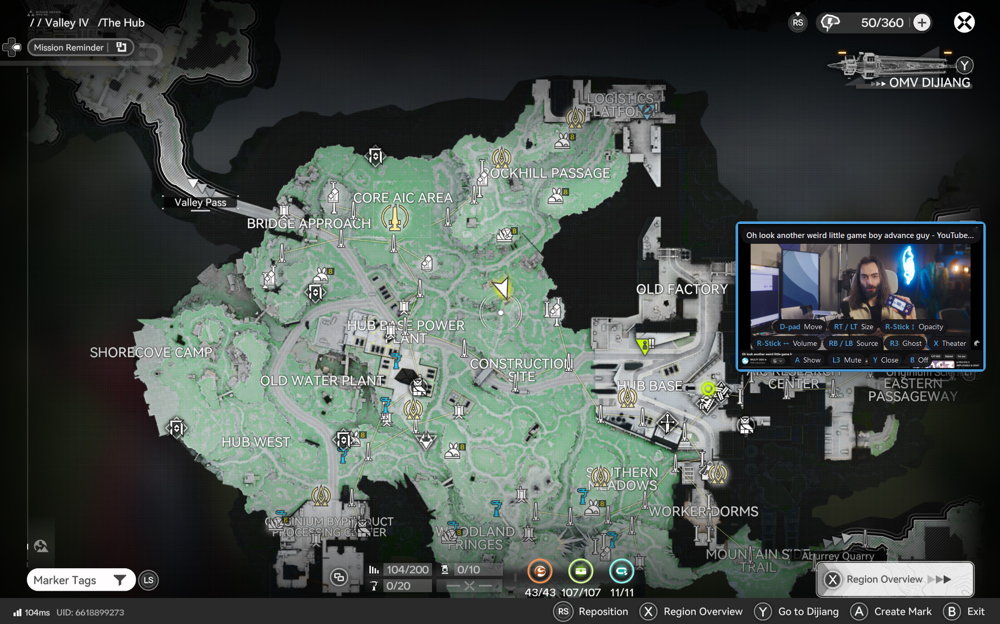

<h1 align="center">PiP Studio</h1>

Picture-in-picture for any window, display or part of the screen on Windows 10 and 11. It also steers other apps' PiP windows and works entirely from a game controller, including in Xbox mode.

  
  &nbsp;
  

The Store version can't run as administrator (so it can't show apps that run as administrator) and has no phone companion. The GitHub version has everything.

  
  

  
  

> **Vibecoded:** PiP Studio was built with the help of AI (Claude). It works well for me, but expect the odd rough edge, and please [report anything weird](../../issues/new/choose).

## Features

- **PiPs** of a window, a whole display or a screen region, always on top, using Windows' own live thumbnails (very light).
- **Auto mode** follows the window you just left.
- **Placement:** 8 sizes, snapping to corners and edges, and PiPs that push each other aside instead of overlapping.
- **Saved layouts:** bring a set of PiPs back in one go, or have them open when an app starts.
- **Per-PiP options:** crop and zoom, theater mode, click-through, opacity, volume and mute, and a title bar with the buttons you pick.
- **Smart hiding** while the source is in front, over full-screen apps, or when you point at a PiP.
- **Other apps' PiPs** (Chrome, Edge, Firefox, Discord and more) work with your shortcuts, controller and title bar. Black bars are trimmed from Discord pop-outs.
- **Controller:** Xbox, PlayStation, Switch and others, with button hints and a controller-friendly layout for the app. Works in Windows' Xbox mode.
- **Phone companion** (GitHub version): control your PiPs and every app's volume from your phone's browser, over your home network, encrypted.
- Light, dark and OLED themes, 9 languages, settings backup, and screen reader support.

## Download

From the [Microsoft Store](https://apps.microsoft.com/detail/9nwjlmr7pfth), or from [Releases](../../releases/latest): the **installer** (no admin needed) or the **portable zip**. Neither needs .NET, and both update themselves from Settings.

Windows may say "Windows protected your PC" because PiP Studio isn't code-signed yet: choose **More info > Run anyway**.

Needs Windows 10 (1809 or later) or 11, 64-bit. The version history is in [CHANGELOG.md](CHANGELOG.md).

## Default shortcuts

| Action | Keys |
|---|---|
| Choose a window to PiP | Ctrl+Alt+P |
| PiP the active window | Ctrl+Alt+O |
| PiP a screen region | Ctrl+Alt+R |
| Previous / next source | Ctrl+Alt+[ / ] |
| Move / next corner | Ctrl+Alt+Arrow keys / C |
| Bigger / smaller | Ctrl+Alt+= / - |
| Theater mode | Ctrl+Alt+F |
| Hide / show all PiPs | Ctrl+Alt+H |
| Close the PiP | Ctrl+Alt+X |
| Controller controls on / off | Ctrl+Alt+G (Start + Select on a controller) |
| Open PiP Studio | Ctrl+Alt+A |

All of them, and more, can be changed on the Shortcuts page.

## Build it yourself

With the [.NET 8 SDK](https://dotnet.microsoft.com/download/dotnet/8.0): `build.bat` builds and starts it; `build.bat release` builds the release exe, the portable zip and, with [Inno Setup 6](https://jrsoftware.org/isdl.php), the installer.

Translations are in `strings.tsv` (Arabic, Chinese) and `lang/<code>.tsv`; run `python make_langdata.py` after editing them. Settings are saved in `%AppData%\PiPStudio`.

## License

[MIT](LICENSE). Uses [WPF UI](https://github.com/lepoco/wpfui) (MIT); see [THIRD-PARTY-NOTICES.md](THIRD-PARTY-NOTICES.md).
