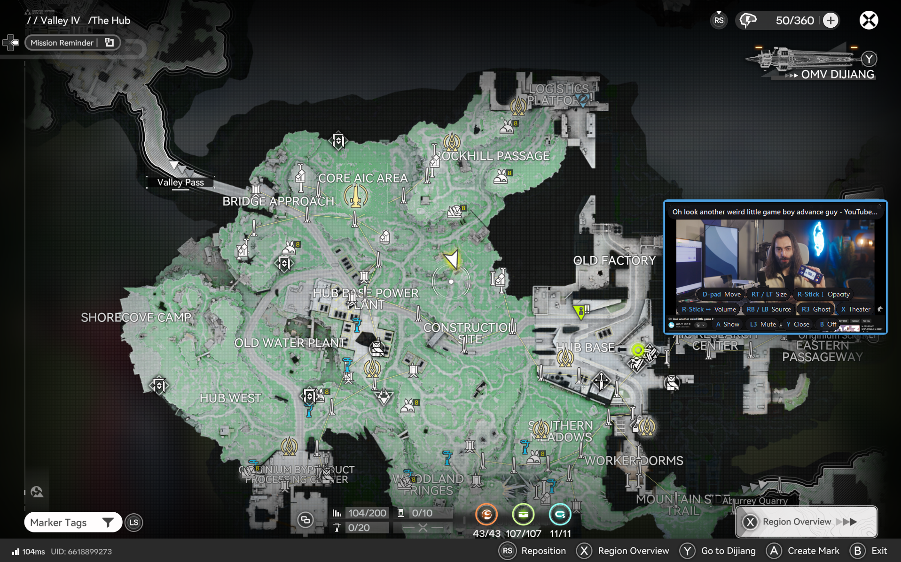
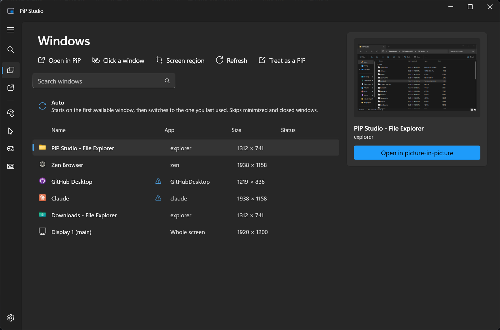
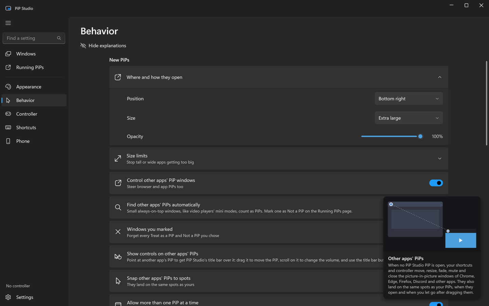
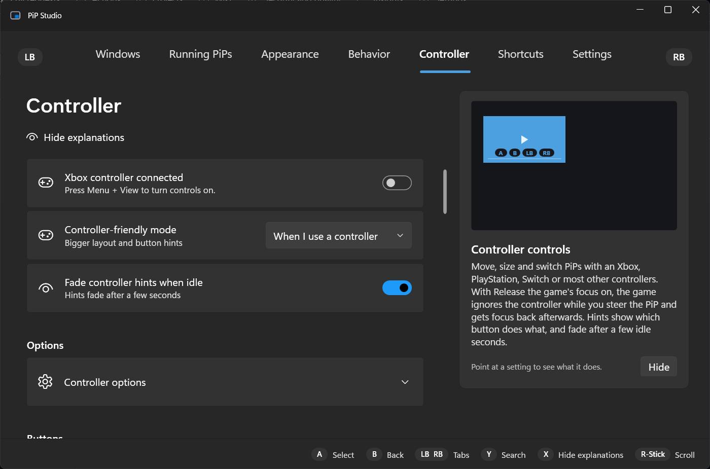

<h1 align="center">PiP Studio</h1>

Picture-in-picture for any window, display or part of the screen on Windows 10 and 11, in the style of the Windows 11 system apps. It can also steer other apps' picture-in-picture windows (browsers, Discord and more) and be used entirely from a game controller.

  
  &nbsp;
  

  
  

  
  

> **Vibecoded:** PiP Studio was built with the help of AI (Claude). It works well for me, but expect the odd rough edge, and please [report anything weird](../../issues/new/choose).

## Download

Get PiP Studio from the **[Microsoft Store](https://apps.microsoft.com/detail/9nwjlmr7pfth)**, which installs and updates it for you, or from the **[Releases](../../releases/latest)** page here. The GitHub versions also include the phone companion, which the Store version doesn't have.

From the Releases page:

- **`PiPStudio-Setup-<version>.exe`** – the installer. It installs for your account only (no admin needed), adds a Start menu shortcut and can start PiP Studio when you sign in. Settings > Apps uninstalls it.
- **`PiPStudio-<version>-win-x64-portable.zip`** – the same app as a single exe that runs without installing.

Neither needs .NET installed. Both keep themselves up to date: PiP Studio checks for a new version once a day and updates when you click **Update now** in Settings > General > Updates.

**"Windows protected your PC"?** PiP Studio isn't code-signed yet, so Windows SmartScreen warns about it the first few times. Choose **More info > Run anyway**. You can always build it yourself from this source code instead (see below).

### Requirements

- Windows 10 (version 1809 or later) or Windows 11, 64-bit
- Desktop composition (always on in Windows 10 and 11)
- Optional: an Xbox, PlayStation, Switch or other game controller

The full version history is in [CHANGELOG.md](CHANGELOG.md).

## Build it yourself

You need the **[.NET 8 SDK](https://dotnet.microsoft.com/download/dotnet/8.0)**.

- **`build.bat`** builds `publish\PiPStudio.exe` and starts it (it needs the .NET 8 Desktop Runtime to run).
- **`build.bat release`** builds the self-contained release exe and the portable zip in `out\`, plus the installer if [Inno Setup 6](https://jrsoftware.org/isdl.php) is installed.

To work on it in Visual Studio or VS Code, open `PiPStudio.csproj`.

## What it does

**PiPs**
- Mirror a window, a whole display or a screen region in a floating, always-on-top PiP. It uses Windows' own live thumbnails, so it costs very little.
- Auto mode starts on the first available window, then follows the window you just left. It skips minimized and closed windows.
- 8 sizes by width (Extra small to Extra large) that keep the PiP's shape, and size limits for tall or wide apps.
- Snaps to the 4 corners and the middle of each edge, with a gap you choose.
- Crop and zoom, theater mode, ghost mode (clicks pass through), opacity, source volume and mute, and media keys.
- A title bar with the buttons you pick, in your order (Previous/Next window, theater, crop and more).
- Smart hiding: while the source window is in front, over full-screen apps, or when you point at it (fade, or slide out of the way).
- Freeze fix for Chromium apps that stop drawing when covered.

**Other apps' PiPs**
- Shortcuts and the controller move, size, fade, mute and close the PiP windows of Chrome, Edge, Firefox, Discord and others. Other apps' floating video windows are found automatically; mark mistakes as Not a PiP, or add a window with Treat as a PiP.
- They snap to the same spots and use the same sizes. Once you steer one, it stays on top.
- Point at one to get PiP Studio's title bar over it: drag it to move the PiP, scroll for volume, minimize it, and use your title bar buttons. Minimized ones stay on the Running PiPs page so you can bring them back.
- Windows you add with Treat as a PiP are listed under Marked as PiPs on the Running PiPs page. Remove a mark there and the window goes back to normal, off always on top.
- Discord pop-outs are sized to the video: black bars are found and trimmed away, and the shape is remembered while the window is open.

**Controller**
- Xbox, PlayStation, Switch and most other controllers, several at once.
- Controller controls for the PiP, with hints, continuous volume, opacity and size, and an option to release the game's focus while you steer.
- A controller-friendly mode for the main window: bigger layout, focus ring, tabs, on-screen keyboard and button hints.

**Phone companion**
- Turn it on on the Phone page, scan the QR code and pair like Moonlight: your phone shows a PIN, you type it into PiP Studio. It runs in the phone's browser (Android or iPhone), no app to install.
- Move, resize, minimize, restore and close any PiP (yours or other apps'), change its opacity and volume, start a PiP, hide them all, or play/pause.
- A volume mixer for every app that's playing sound, right under the PiP controls.
- Install it on your home screen with the Install app button, and it opens full screen like an app.
- Local network only, and everything between phone and PC is encrypted with a key set up during pairing. Nothing goes over the internet.

**Main window**
- Windows page: search, the list of windows with a live preview and the freeze warning.
- Running PiPs page, including other apps' PiPs, with options for each one (opacity, volume, size, shape, black bars, snapping), and the windows you marked as PiPs.
- Settings with animated explanations, settings search, Lite mode for slower PCs, and light and dark themes with your accent color.
- The window picker (Ctrl+Alt+P) uses the same look.

## Default shortcuts

| Action | Keys |
|---|---|
| Choose a window to PiP | Ctrl+Alt+P |
| PiP the active window | Ctrl+Alt+O |
| PiP a screen region | Ctrl+Alt+R |
| Start a PiP on Auto | Ctrl+Alt+I |
| Previous / next source | Ctrl+Alt+[ / ] |
| Move | Ctrl+Alt+Arrow keys |
| Next corner / next display | Ctrl+Alt+C / N |
| Bigger / smaller | Ctrl+Alt+= / - |
| More / less opaque | Ctrl+Alt+Page Up / Page Down |
| Theater mode | Ctrl+Alt+F |
| Ghost mode (click-through) | Ctrl+Alt+T |
| Hide / show all PiPs | Ctrl+Alt+H |
| Show the source window | Ctrl+Alt+S |
| Mute / volume up / volume down | Ctrl+Alt+M / Ctrl+Alt+Shift+Up / Down |
| Play / pause | Ctrl+Alt+Space |
| Crop | Ctrl+Alt+K |
| Close the PiP | Ctrl+Alt+X |
| Controller controls on / off | Ctrl+Alt+G (Start + Select on a controller) |
| Open PiP Studio | Ctrl+Alt+A |

You can change them all on the Shortcuts page.

## Settings

Settings and open PiPs are saved in `%AppData%\PiPStudio`.

## Translations (test)

Settings → General → Language offers English, Spanish, Portuguese (Brazil), French, German, Russian, Japanese, Arabic and Chinese (Simplified), or follows Windows. The layout doesn't change; Arabic text reads right to left inside it. The phone companion page is in English.

Arabic and Chinese are in `strings.tsv`; the other languages are in `lang/<code>.tsv` (English, a tab, the translation). After editing any of them, run `python make_langdata.py`. A line missing from a language file just shows in English.

## License

PiP Studio is open source under the [MIT License](LICENSE). It uses [WPF UI](https://github.com/lepoco/wpfui) (MIT); see [THIRD-PARTY-NOTICES.md](THIRD-PARTY-NOTICES.md).
